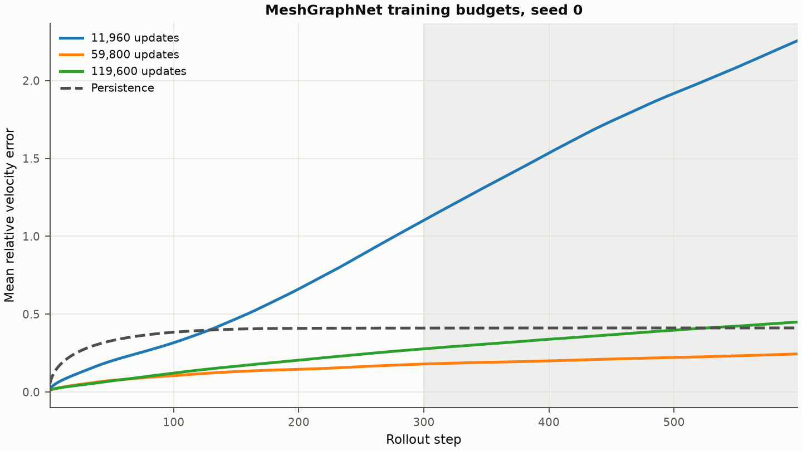
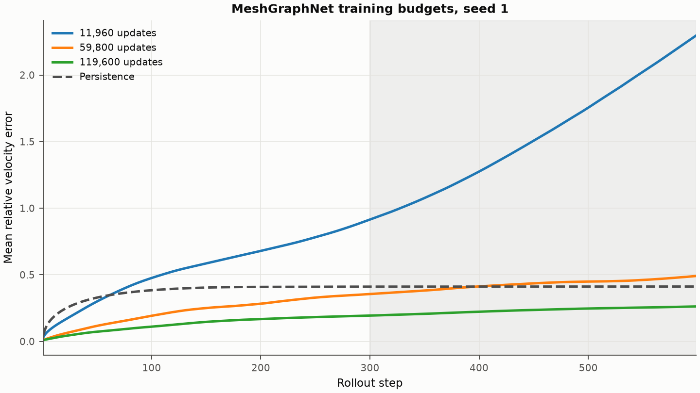

# Training budget and long-horizon wake fidelity

Does increasing the number of Adam updates improve autoregressive accuracy and preserve
vortex shedding at fixed MeshGraphNet depth? The reduced depth study used 40 training
trajectories. Its 11,960-step runs cannot serve as the control for a 200-trajectory
experiment.

## Matched design

For each seed (0, 1, 2), train one MeshGraphNet with ten processor blocks and latent
width 128, and save its weights after exactly 11,960, 59,800 and 119,600 updates. The
first cutoff is 20% of the first shuffled epoch. Each longer cutoff continues the
same sample order and optimisation trajectory. The checkpoints are paired by seed.

Use the first 200 training, 10 validation and 50 test trajectories of DeepMind's
cylinder-flow dataset. Training and validation use the first 300 time levels. The
upstream batch size of 1, Adam with initial learning rate 0.0001 and decay multiplier
0.9999991 per update, normalisation, training noise and boundary conditions are
inherited from the existing PhysicsNeMo configuration. This estimates the effect of
additional updates under the fixed schedule, including the additional learning-rate
decay that accompanies them. It does not isolate the effect of changing the schedule.

## CUDA verification and costs

Use the [Kaggle notebook](../kaggle/training_budget.ipynb) with Internet access and a
T4 accelerator. It checks out a full Git SHA and installs the pinned PhysicsNeMo
revision in a virtual environment that excludes the base image’s optional RAPIDS
packages. It verifies PyTorch, PyG and CUDA sum aggregation through torch_scatter,
runs the tests and the existing CUDA smoke experiment, then times K=10 on one visible
GPU. The CPU-only torch_scatter build uses PyTorch's CUDA scatter-add for sum. The
probe reports synchronised throughput after 50 warm-up steps, over 300 measured
steps. It records CUDA peak allocated training memory, training and validation data
setup time, validation-pass time and 599-step inference time for one trajectory.

Gradient runtime at cutoff (s) is (s / r) seconds for measured throughput (r).
The notebook also projects validation, setup and evaluation overhead separately
from the gradient estimate and budgets for all three seed trajectories. These
projections are sensitive to the single probe mesh, machine load and CPU diagnostic
cost. A stage starts only if it fits the notebook's remaining time allowance.

Start with `STAGE = "probe"`. After successful verification, `STAGE = "seed0"`
trains through 119,600 and evaluates the extended and baseline snapshots. Evaluate
the intermediate cutoff and additional seeds with `STAGE = "followup"` if the seed-0
comparison warrants replication. Supply the Kaggle notebook version in the notebook
configuration for provenance.

## Checkpoints and outputs

Each seed writes step-numbered training states under `training_state/` and publishes
separate immutable model snapshots under `steps_*/mp10_seed*/`. Training states
store the model, optimiser, scheduler, AMP scaler, RNG state, data-loader generator
state and loss history. The state is written atomically. An interrupted invocation
reconstructs the same shuffled epoch and consumes its already completed prefix
before the next update. CUDA reduction kernels can introduce numerical variation
across otherwise equivalent executions. SHA-256 hashes of the actual dataset files are verified on
resume. Reuse the same Git SHA, device class, package versions and configuration.

For Kaggle resumption, attach the trusted prior notebook version's saved outputs and
set `RESUME_FROM` to its `training_budget` directory. Successful notebook versions
export that directory under `/kaggle/working`. A hard termination before Kaggle
publishes outputs can make that session's checkpoints inaccessible. The notebook
sets a wall-time limit for the training subprocess to give Kaggle time to publish.

The equivalent commands after CUDA verification and dataset setup are

```bash
python scripts/training_budget.py --mode train --seed 0
python scripts/training_budget.py --mode evaluate --seed 0 --cutoff 119600
python scripts/training_budget.py --mode evaluate --seed 0 --cutoff 11960
```

## Evaluation

Each model is evaluated over 599 autoregressive steps. The standard metric file
reports one-step velocity-increment and pressure errors, and velocity, pressure,
vorticity and kinetic-energy errors at steps 1, 10, 100, 299 and 599. The rollout
curves also contain the velocity persistence baseline, which holds the initial
velocity fixed. The wake analysis derives frequency, amplitude, phase, wake profile,
peak speed and energy drift from the same rollouts. The preserved-shedding count
uses the established criteria at the three-diameter probe. The predicted dominant
frequency must lie in the reference band and predicted band power must reach
25% of the reference. See [Long-horizon diagnostics](LONG_HORIZON_DIAGNOSTICS.md).

For the seed-0 comparison, report both endpoints on the same 50 trajectories and
separate gains in one-step error from changes in the shedding-preservation rate,
time to amplitude loss, extrapolation-window velocity error and step-599 energy
ratio. The evaluation command writes a per-seed comparison JSON with the endpoint
metrics and differences from the 11,960-step baseline when available. Treat any single-seed comparison as descriptive. Use seed-paired comparisons
for replication, with trajectories nested within seed.

## Evidence

The published depth-study results remain in [results/local](../results/local/).
The matched-data results below come from separate CUDA runs.

### Single-T4 benchmark

Kaggle notebook version 4 used commit `25cbdf0604e55f21729e7719fe8dd009f217bce7`
and one Tesla T4 (14.56 GiB visible). CUDA was available with PyTorch
2.15.0+cu132, PhysicsNeMo 2.3.0a0, PyG 2.8.1 and torch_scatter 2.1.2.
CUDA sum aggregation, the existing 38-step smoke training and checkpoint
reload, and smoke rollouts passed. Kaggle pytest reported 81 passed and
3 skipped. The isolated environment, headless plotting backend and explicit
CUDA allocator initialization resolved image and runtime compatibility failures.

| Measurement | Value |
|---|---:|
| Throughput after 50 warm-up steps, over 300 measured updates | 26.71 steps/s |
| Time per gradient step | 37.44 ms |
| Peak allocated GPU training memory | 468.76 MiB |
| Train and validation setup | 17.62 s |
| Validation pass | 4.09 s |
| One test trajectory setup | 0.14 s |
| 599-step probe rollout | 9.13 s |

Projected gradient time to 11,960, 59,800 and 119,600 steps was 7.46, 37.32
and 74.63 minutes, respectively. The notebook projected 1.89 hours for
seed-0 training and two evaluations and 6.35 hours for three seeds with
three evaluations each, excluding notebook setup. Seed-0 training actually
took 82.77 minutes through 119,600 steps, including 81.65 minutes of
optimisation at 24.41 steps/s. The two evaluations took about 12.75 minutes
each. The benchmark used one test trajectory, so extrapolations are approximate.

### Seed 0

Both checkpoints use the same 200 training trajectories and the same 50
test trajectories. Validation MSE fell from 0.1014 to 0.0421. The
intermediate training checkpoint has validation MSE 0.0762.

| Metric | 11,960 steps | 119,600 steps |
|---|---:|---:|
| One-step relative velocity-increment error | 0.480 | 0.291 |
| One-step relative pressure error | 0.571 | 0.251 |
| Mean relative velocity error, steps 300–599 | 1.712 | 0.366 |
| Mean predicted/reference kinetic-energy ratio, step 599 | 11.468 | 0.685 |
| Median step when in-band amplitude fell below half, censored at 600 | 76 | 362 |
| Shedding preserved, steps 100–299 | 0/36 | 25/36 |
| Shedding preserved, steps 300–599 | 0/36 | 19/36 |



Mean errors over the 50 trajectories. Each paired entry is baseline / extended.

| Step | Relative velocity | Relative pressure | Relative vorticity | Relative energy error | Velocity persistence |
|---:|---:|---:|---:|---:|---:|
| 1 | 0.021 / 0.012 | 0.666 / 0.361 | 0.128 / 0.064 | 0.014 / 0.003 | 0.052 |
| 10 | 0.073 / 0.028 | 0.483 / 0.287 | 0.227 / 0.078 | 0.040 / 0.016 | 0.182 |
| 100 | 0.317 / 0.121 | 1.092 / 0.331 | 0.519 / 0.182 | 0.217 / 0.160 | 0.384 |
| 299 | 1.099 / 0.277 | 3.561 / 0.522 | 1.165 / 0.398 | 2.882 / 0.289 | 0.411 |
| 599 | 2.257 / 0.449 | 6.155 / 0.990 | 2.340 / 0.608 | 10.565 / 0.370 | 0.412 |

The longer-trained model improves one-step prediction and preserves shedding
in roughly half the reference shedding cases over steps 300–599. Its mean
velocity error at step 599 still exceeds persistence, and its mean energy
ratio indicates a deficit. All 100 evaluated rollouts remained finite.
These observations apply to seed 0 and the chosen 50 trajectories.

The [numerical outputs](../results/training_budget/) include per-trajectory
frequency and amplitude diagnostics, rollout curves, training histories,
dataset hashes and checkpoint checksums. The weights and training states
are available in the [Kaggle notebook output](https://www.kaggle.com/code/adebanjiadelowo/mgn-vortex-budget-t4-seed-0/output).


### Two-seed comparison

The follow-up evaluated the saved seed-0 intermediate checkpoint and trained
and evaluated all three seed-1 checkpoints. Both seeds used the same dataset
manifest. Each triplet is ordered 11,960 / 59,800 / 119,600 updates.

| Metric | Seed 0 | Seed 1 |
|---|---:|---:|
| One-step relative velocity-increment error | 0.480 / 0.341 / 0.291 | 0.581 / 0.326 / 0.302 |
| One-step relative pressure error | 0.571 / 0.523 / 0.251 | 0.610 / 0.338 / 0.258 |
| Mean relative velocity error, steps 300–599 | 1.712 / 0.211 / 0.366 | 1.537 / 0.427 / 0.232 |
| Mean predicted/reference kinetic energy, step 599 | 11.468 / 0.996 / 0.685 | 8.777 / 1.989 / 0.709 |
| Shedding preserved, steps 300–599 | 0 / 10 / 19 of 36 | 0 / 13 / 3 of 36 |
| Median step when amplitude fell below half, censored at 600 | 76 / 96.5 / 362 | 95 / 143.5 / 76 |

Both larger budgets improved one-step and late-rollout accuracy relative to
the baseline in both seeds. Increasing the budget from 59,800 to 119,600
improved one-step accuracy in both seeds, but its effect on late-rollout
error and shedding preservation depended on the seed. Both extended
checkpoints showed a mean kinetic-energy deficit at step 599.

At step 599, the intermediate seed-0 model and extended seed-1 model
had mean velocity errors of 0.245 and 0.262, below the persistence error
of 0.412. The other four checkpoints exceeded persistence at that step.
Seed 1 took 81.17 minutes to train, and its evaluations took 12.29–12.43
minutes each. The follow-up T4 probe measured 26.80 steps/s and 468.76 MiB
peak allocated training memory.

All 300 evaluated rollouts remained finite. The two seed trajectories give
a descriptive comparison. Kaggle reported 0.99 GPU hours after the
follow-up, below its 2.10-hour projection for the third seed with three
evaluations, excluding setup. Seed 2 remains to be evaluated.



See the [follow-up notebook outputs](https://www.kaggle.com/code/adebanjiadelowo/mgn-vortex-budget-t4-followup/output).

### Rollout errors by horizon

Means over 50 trajectories. Persistence is the relative velocity error of the fixed initial state.

| Seed | Updates | Step | Velocity | Pressure | Vorticity | Energy | Persistence |
|---:|---:|---:|---:|---:|---:|---:|---:|
| 0 | 11,960 | 1 | 0.021 | 0.666 | 0.128 | 0.014 | 0.052 |
| 0 | 11,960 | 10 | 0.073 | 0.483 | 0.227 | 0.040 | 0.182 |
| 0 | 11,960 | 100 | 0.317 | 1.092 | 0.519 | 0.217 | 0.384 |
| 0 | 11,960 | 299 | 1.099 | 3.561 | 1.165 | 2.882 | 0.411 |
| 0 | 11,960 | 599 | 2.257 | 6.155 | 2.340 | 10.565 | 0.412 |
| 0 | 59,800 | 1 | 0.011 | 0.352 | 0.045 | 0.003 | 0.052 |
| 0 | 59,800 | 10 | 0.030 | 0.385 | 0.079 | 0.009 | 0.182 |
| 0 | 59,800 | 100 | 0.105 | 0.676 | 0.214 | 0.049 | 0.384 |
| 0 | 59,800 | 299 | 0.180 | 0.617 | 0.318 | 0.154 | 0.411 |
| 0 | 59,800 | 599 | 0.245 | 0.652 | 0.418 | 0.253 | 0.412 |
| 0 | 119,600 | 1 | 0.012 | 0.361 | 0.064 | 0.003 | 0.052 |
| 0 | 119,600 | 10 | 0.029 | 0.287 | 0.078 | 0.016 | 0.182 |
| 0 | 119,600 | 100 | 0.121 | 0.331 | 0.182 | 0.160 | 0.384 |
| 0 | 119,600 | 299 | 0.277 | 0.522 | 0.398 | 0.289 | 0.411 |
| 0 | 119,600 | 599 | 0.449 | 0.990 | 0.608 | 0.370 | 0.412 |
| 1 | 11,960 | 1 | 0.033 | 0.743 | 0.216 | 0.016 | 0.052 |
| 1 | 11,960 | 10 | 0.108 | 0.607 | 0.361 | 0.101 | 0.182 |
| 1 | 11,960 | 100 | 0.476 | 1.080 | 0.665 | 0.328 | 0.384 |
| 1 | 11,960 | 299 | 0.912 | 2.384 | 1.099 | 1.162 | 0.411 |
| 1 | 11,960 | 599 | 2.297 | 4.755 | 1.738 | 8.255 | 0.412 |
| 1 | 59,800 | 1 | 0.011 | 0.444 | 0.046 | 0.003 | 0.052 |
| 1 | 59,800 | 10 | 0.036 | 0.319 | 0.077 | 0.031 | 0.182 |
| 1 | 59,800 | 100 | 0.192 | 0.524 | 0.298 | 0.287 | 0.384 |
| 1 | 59,800 | 299 | 0.355 | 0.818 | 0.506 | 0.655 | 0.411 |
| 1 | 59,800 | 599 | 0.491 | 1.033 | 0.652 | 1.042 | 0.412 |
| 1 | 119,600 | 1 | 0.009 | 0.322 | 0.041 | 0.003 | 0.052 |
| 1 | 119,600 | 10 | 0.025 | 0.280 | 0.069 | 0.019 | 0.182 |
| 1 | 119,600 | 100 | 0.110 | 0.334 | 0.179 | 0.127 | 0.384 |
| 1 | 119,600 | 299 | 0.193 | 0.421 | 0.294 | 0.208 | 0.411 |
| 1 | 119,600 | 599 | 0.262 | 0.461 | 0.359 | 0.291 | 0.412 |
